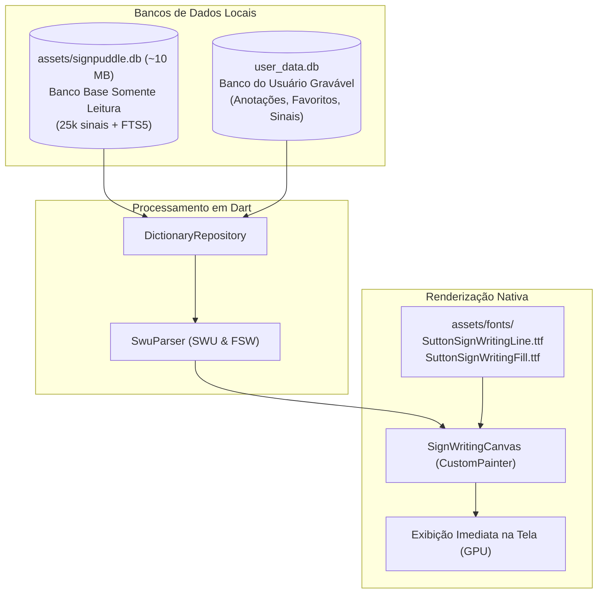

# Escrita de Libras

App Flutter (Dart 3) para pesquisa e estudo de sinais de **Libras (Língua Brasileira de Sinais)** com desenho em **SignWriting**, utilizando o vocabulário público brasileiro consolidado do [SignPuddle 3](https://signpuddle.com/).

O aplicativo funciona de forma **100% offline**: você digita uma palavra em português, o termo é localizado instantaneamente em um **SQLite local**, e o sinal em SignWriting é desenhado na tela de forma vetorial nativa e acelerada por GPU através das fontes TrueType oficiais do **Sutton SignWriting**, eliminando qualquer dependência de download de imagens ou conexão de rede.

---

## Funcionalidades

- **Exclusivo para Libras**: Dicionário restrito e blindado para a Língua Brasileira de Sinais (`bzs-BR-dictionary-public`), com termos e expressões em português.
- **Busca Local Ultra-Rápida**: Consulta em ~25.611 sinais e ~39.802 termos, com tolerância a acentos, busca por prefixo, índice FTS5 (busca textual completa) e substring.
- **Renderização Nativa por Fontes (100% Offline)**: Desenho imediato no Canvas do Flutter utilizando as fontes `SuttonSignWritingLine` e `SuttonSignWritingFill`. Zero consumo de dados móveis e zero latência.
- **Modo Escuro / Claro Dinâmico**: Os traços e o preenchimento dos sinais adaptam-se automaticamente ao tema do sistema (ex.: traços brancos nítidos no tema escuro e traços escuros no tema claro).
- **Metadados Pessoais por Sinal**: Adicione anotações, tags e termos complementares em qualquer sinal. Seus dados entram na busca e ficam salvos em um banco de dados separado.
- **Sinais Manuais com Prévia ao Vivo**: Cadastre novos sinais colando códigos em **SWU** (Unicode) ou **FSW** (ASCII), com prévia imediata desenhada na hora.
- **Favoritos e Histórico de Buscas**.
- **Backup dos Seus Dados**: Exporte e importe suas anotações, favoritos e sinais manuais em formato JSON via área de transferência.

---

## Arquitetura de Armazenamento e Desenho



### Arquitetura de Banco Duplo
1. **Banco Base (`assets/signpuddle.db`, ~10 MB)**: Contém o dicionário compilado pelo script Python. É aberto em modo `readOnly: true`. Uma atualização futura deste banco **nunca sobrescreve dados do usuário**.
2. **Banco do Usuário (`user_data.db`)**: Armazena as personalizações locais, garantindo total privacidade e persistência.

---

## Estrutura do Projeto

```
lib/
  main.dart                      Entrypoint + inicialização desktop FFI
  app.dart                       MaterialApp, splash e rotas
  core/
    app_info.dart                Identificadores do dicionário e versões
    swu_parser.dart              Parser de SWU (Unicode) e FSW (ASCII)
    text_normalizer.dart         Normalização de busca e query FTS5
    format.dart                  Formatadores de data, contagem e bytes
    sign_image_url.dart          URLs auxiliares do SignPuddle
    sign_svg.dart                Normalizador de SVG legado (fallback)
  data/
    models.dart                  Modelos de dados (SignEntry, SignNote, SignKind)
    base_database.dart           SQLite base (read-only) + motor de busca
    user_database.dart           SQLite do usuário (anotações, favoritos, manual)
    dictionary_repository.dart   Repositório unificado (base + usuário)
  services/
    sign_image_service.dart      Serviço de fallback para imagens externas
  state/
    app_state.dart               Gerenciador de estado global (ChangeNotifier)
  ui/
    theme.dart                   Material 3 (claro e escuro)
    home_screen.dart             Busca, sugestões, histórico e listagem
    sign_detail_screen.dart      Detalhes do sinal, zoom e anotações
    favorites_screen.dart        Lista de sinais favoritos
    settings_screen.dart         Gerenciamento de dados, tema e sobre
    custom_sign_screen.dart      Criação/edição de sinais manuais
    widgets/
      sign_writing_canvas.dart   Pintura nativa de SignWriting via fontes TTF
      sign_writing_image.dart    Container do sinal com seleção canvas/fallback
      sign_card.dart             Card da lista de resultados
      section_card.dart          Cards de seções informativas
      note_editor_sheet.dart     Editor de anotações (bottom sheet)

tools/signpuddle/
  build_sqlite.py                Gera assets/signpuddle.db a partir do JSON do SP3
  fetch_dictionary.py            Baixa o JSON do SignPuddle 3
  sync.py                        Executa fetch + build em lote
  list_dictionaries.py           Lista dicionários da API pública
  download_images.py             Downloader opcional de SVGs para o banco
  normalize.py                   Mesma regra de normalização de termos usada no Dart
  tests/                         Testes unitários do tooling Python

assets/
  fonts/                         Fontes TTF (SuttonSignWritingLine e Fill)
  signpuddle.db                  Dicionário base pré-compilado
  sample_sign.svg                Amostra de sinal para demonstração
```

---

## Como Executar

### 1. Aplicativo Flutter (Android / Linux)

```bash
# Obter dependências
flutter pub get

# Rodar no dispositivo/emulador conectado
flutter run

# Executar testes
flutter test

# Análise estática de código
flutter analyze
```

### 2. Gerar / Atualizar o Banco SQLite (Python)

O banco `assets/signpuddle.db` já está incluído e pronto para uso no repositório. Caso queira sincronizar com as atualizações mais recentes do SignPuddle 3:

```bash
pip install -r tools/signpuddle/requirements.txt
python -m tools.signpuddle.sync
```

*(O JSON baixado (~20 MB) fica isolado em `tools/signpuddle/data/raw/` e é ignorado pelo Git; apenas o `.db` otimizado final é versionado).*

---

## Testes

O projeto conta com suite de testes automatizados completa:

```bash
# Testes do Flutter (26 testes unitários e de widgets)
flutter test

# Testes do Tooling Python (7 testes de normalização e SQLite)
python -m unittest discover -s tools/signpuddle/tests -v
```

---

## Build e Release

```bash
# APK universal (todas as ABIs em um arquivo)
flutter build apk --release

# APKs separados por ABI (menores) + App Bundle
flutter build apk --release --split-per-abi
flutter build appbundle --release
```

O CI/CD fica em `.github/workflows/`:

- `ci.yml` — análise estática e testes (Flutter + tooling Python) em pushes na
  `main`, pull requests e execução manual.
- `build-release.yml` — em tags `v*` (ou execução manual) gera APKs por ABI,
  APK universal e AAB, verifica a assinatura e publica no GitHub Release.

A assinatura de release usa os secrets `KEYSTORE_BASE64`,
`KEYSTORE_PASSWORD`, `KEY_ALIAS` e `KEY_PASSWORD`. O guia completo (geração do
keystore, fluxo de tag e envio à Play Store) está em
[docs/RELEASE.md](docs/RELEASE.md).

---

## Plataformas Suportadas

- **Android**: Suporte completo (validado em hardware real).
- **Linux Desktop**: Suporte completo (requer `libsqlite3`).
- **Web**: Compila para demonstração de interface, exibindo aviso informativo sobre a necessidade de SQLite local no dispositivo.

---

## Dados e Atribuição

Os sinais e metadados base têm origem no dicionário público `bzs-BR-dictionary-public` do projeto SignPuddle, idealizado por **Valerie Sutton** (SignWriting) e desenvolvido por **Steve Slevinski**. As fontes TrueType pertencem ao projeto oficial `@sutton-signwriting/font-ttf`.

Cada verbete pertence aos colaboradores listados no campo de fonte (`source`). Este projeto não se responsabiliza pelo conteúdo linguístico, funcionando como ferramenta educacional para estudo de Libras.

---

## Licença

Este software é livre e licenciado sob a [GPL-3.0](LICENSE).
